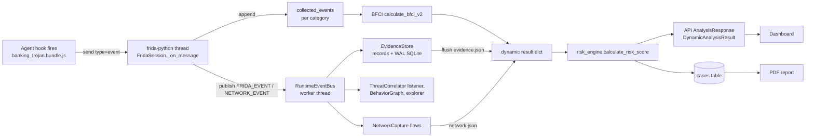

# SUDARSHAN — Reliability Audit (dynamic analysis & evidence pipeline)

> **Date:** 2026-10-11
> **Scope:** APK upload → validation → static analysis → sandbox → Frida instrumentation → runtime telemetry → evidence persistence → BFCI / risk → API → report → dashboard.
> **Companion document:** [`IMPLEMENTATION_REPORT.md`](IMPLEMENTATION_REPORT.md) — what was changed and how it was verified.

Every defect below is marked **Confirmed** (reproduced by a test or a direct check against the original code) or **Hypothesis** (supported by code reading or by notes in the code, but not reproduced here). No Android device or emulator was available for this audit: the host has no `/dev/kvm` and no `adb`. Nothing in this document is a device-level claim.

---

## 1. Real entry points

| Entry point | File | Role |
| :--- | :--- | :--- |
| `POST /api/v1/analyze` (sync) | `backend/app/routes/upload.py::analyze_upload` | Reserve job slot → `_receive_apk` → `_run_analysis_pipeline` |
| `POST /api/v1/analyze/async` | `backend/app/routes/upload.py::analyze_upload_async` | Reserve job slot → `_receive_apk` → `workers/analysis_queue.enqueue` (durable queue) |
| Gateway pipeline | `upload.py::_run_analysis_pipeline` | Delegates to the analysis engine (`_call_analysis_engine`); local fallback only if `SUDARSHAN_ALLOW_GATEWAY_DYNAMIC` |
| Analysis engine | `analysis-engine/app/main.py::_execute_analysis_pipeline` | **Primary path**: static (MobSF → Androguard fallback), APKTool, JADX, `run_frida_analysis`, correlation, `risk_engine.calculate_risk_score` |
| Dynamic analysis | `shared/sudarshan_core/engines/frida_sandbox.py::run_frida_analysis` → `_run_device_session` → `FridaSession.run` | Device lock, install, spawn-gated launch / launch ladder, Frida attach, agent load, AgenticExplorer, teardown, result assembly |
| Multi-stage | `shared/sudarshan_core/engines/multi_stage_engine.py` | Optional (`SUDARSHAN_MULTISTAGE=true`): four device-state stages |
| Frida agent | `shared/sudarshan_core/engines/frida_hooks/banking_trojan.js` → `banking_trojan.bundle.js` (frida-compile, frida-java-bridge linked) | Java + native hooks, `send()` to host |
| Report | `shared/sudarshan_core/engines/pdf_generator.py` (PDF), `report_generator.py` (HTML artifact) | |
| Dashboard | `frontend/src/components/case/RuntimeStatus.tsx` and investigation views | |

## 2. Runtime-event data flow

Two independent copies of every event exist: `collected_events` (scored by BFCI) and the EvidenceStore records (cited by reports). They must agree; before this work nothing tied them together.

## 3. Where runtime events can disappear (zero-event investigation)

The reported symptom: Frida attachment succeeds, yet a run produces zero runtime events. Each stage below was checked for a way to lose events silently.

| # | Stage | Loss mechanism | Status |
| :--- | :--- | :--- | :--- |
| L1 | Agent bundle | Bundle not built / Java bridge not linked → every Java hook skipped | **Ruled out for the checked-in bundle**: loaded with real Frida 17.16.4 (local Linux process); it compiles, sends the canary and reports `java_bridge_source: frida-java-bridge`. Bundle body matches `banking_trojan.js`. Java hooks cannot be exercised without ART. |
| L2 | Agent load on the launch-ladder path | `create_script`/`load` exception logged as a warning only; result carried no trace | **Confirmed** (code: `frida_sandbox.py` ladder attach) |
| L3 | Session lifetime | **No `detached` handler anywhere.** A session lost mid-run (process death, frida-server crash, transport loss) left the run waiting out the window and reporting "no events" — indistinguishable from a quiet sample | **Confirmed** (grep: zero `detached` registrations; real-Frida test now observes `process-terminated`) |
| L4 | Host message callback | An exception inside `_on_message` is printed by frida-python and the event is gone; non-dict payloads raised before counting | **Confirmed** (unit test drives a handler exception) |
| L5 | `get_tracker` in the callback | Unlocked `OrderedDict` shared between frida's thread and the controller; a concurrent eviction can raise **after** the event is appended but **before** it is published, so `collected_events` has it and EvidenceStore does not | Hypothesis (race visible in code; not reproduced). Now recorded as a handler exception / unpublished event instead of silent. |
| L6 | RuntimeEventBus worker | `task_done()` skipped on the worker's error path → `drain()` times out forever after one error → evidence flushed before delivery | **Confirmed** (old code: `drain()` returned False after a single worker error) |
| L7 | Evidence flush | `event_bus._queue.join()` — **no timeout** — called while holding the device lock; one stuck subscriber wedged the whole analysis and the queue behind it | **Confirmed** (code) |
| L8 | Event-bus capacity | Unbounded queue, no drop accounting | **Confirmed** (code); now bounded with counted drops |
| L9 | EvidenceStore build | `data: None`, non-numeric timestamp, or a hook only at top level → record dropped or filed as `unknown` | **Confirmed** (old code dropped `data: None` events) |
| L10 | Agent JS event loop | Code note: "zero pings received over 18s" on a live device — the agent's timers do not fire once loaded | Hypothesis carried from code comments. **Not reproduced**: on the local host pings arrive every 3 s. If the JS thread is genuinely wedged on Android, hook callbacks would also block; the new diagnostics will show `canary` but no `ping`/`event` messages in that case. |
| L11 | Timing / ART | Agent skips `deoptimizeEverything` and `deoptimizeBootImage` on API 34+ (ANR avoidance); inlined boot-image callers can bypass hooks on framework methods; late attach on the ladder path misses startup | Hypothesis, documented in agent and `INSTRUMENTED_TOO_LATE` status. The agent's `diag` milestones are now recorded so a report states which applied. |
| L12 | API response | `DynamicAnalysisResult` dropped `error`, `runtime_attempted` and all diagnostics, so the dashboard could not show *why* a run produced nothing | **Confirmed** (code) |

**Root cause status:** the zero-event failure on the problematic Android environment is **not yet root-caused** — it requires a device. What this audit established is that the pipeline previously had at least four confirmed ways (L2, L3, L4, L6/L7) to produce a zero-event-looking result without recording why, so the original symptom could not be diagnosed from a run's output. Those are now instrumented (`telemetry_diagnostics`) so the next device run classifies itself.

## 4. Other verified defects

| ID | Area | Defect | Evidence |
| :--- | :--- | :--- | :--- |
| D1 | Upload API | `POST /api/v1/analyze` raised `UnboundLocalError` on **every call**: a function-local `import os` made `os` local to the whole function, and the first line calls `os.getenv` | **Confirmed** (AST check on committed code; E2E test now passes) |
| D2 | Upload API | A rejected upload (bad extension / magic / empty / too large) left its reserved job row `UPLOADING` forever; `UPLOADING` counts toward `MAX_QUEUE_DEPTH` | **Confirmed** (code; regression test) |
| D3 | Gateway | Dynamic exception → `dynamic_result = None`, which reads as "never requested" | **Confirmed** (code) |
| D4 | Analysis engine | Dynamic exception propagated out of the pipeline → 500 → gateway fails closed → completed static analysis discarded | **Confirmed** (code) |
| D5 | MultiStageEngine | Every stage labelled `"success"` regardless of `dynamic_status`; skipped stages vanished; profile failures ignored (a "sim_active" stage could run on an unmodified device); no device reset on exception; a failed stage could become the primary result; all-failed returned a bare `{"error": ...}` | **Confirmed** (code; tests) |
| D6 | MultiStageEngine | The "rebooted" stage sends a `BOOT_COMPLETED` broadcast; it does not reboot. The "banking_apps" stage creates data directories, not installed apps, and reported success even when every `mkdir` failed | **Confirmed** (provider code) — now disclosed as stage limitations |
| D7 | batch_runner | `MultiStageEngine(device_serial, str(apk))` — arguments reversed | **Confirmed** (code) |
| D8 | BFCI | Duplicate deliveries inflate the score (`len(events)`); one re-delivered SMS event: 14.2 → 22.5 | **Confirmed** (old code) |
| D9 | BFCI | Unstamped events treated as `t=0` → spurious ×1.25 sequence bonus | **Confirmed** (old code returned `OTP_THEFT_CHAIN` for three unstamped events) |
| D10 | BFCI | `code_execution` contribution (weight 0.10) had no explanation string | **Confirmed** (code) |
| D11 | EvidenceStore | No de-duplication, random-only ids, no provenance, no synthetic-event isolation | **Confirmed** (old code stored 2 records for one event delivered twice) |
| D12 | Network | One shared HAR ingested whole — other samples' traffic attributed to this analysis; the engine re-read it a second time unbounded | **Confirmed** (code) |
| D13 | Network | Native `connect()` flows labelled HTTP `GET`; HAR `Authorization`/`Cookie` values copied into results | **Confirmed** (code) |
| D14 | Report | PDF sandbox-metadata table printed fixed strings — "Canary received at T+0.4s", "deoptimizeEverything executed successfully", "0 loop detections" — for every run | **Confirmed** (code) |
| D15 | Report | Any non-empty dynamic dict counted as "ran": an `EMULATOR_UNAVAILABLE` case printed "An instrumented run was performed." | **Confirmed** (E2E test) |
| D16 | Risk output | `dynamic_exclusion_reason` was `None` whenever dynamic was unavailable, though the axis was excluded | **Confirmed** (E2E test) |
| D17 | Dashboard | Zero-event card read "no hostile behavioural actions triggered"; "Hooks" tile showed an event count | **Confirmed** (code) |
| D18 | Agent config | Manifest package name inserted into agent source with only `"`/`\` stripped; a newline broke the agent | **Confirmed** (code; real-Frida test) |
| D19 | Docs | BFCI doc stated a 15 s window (code: 30 s); network doc claimed POST-body inspection that is not implemented | **Confirmed** |

## 5. Baseline test results (before changes)

Command: `PYTHONPATH=backend:shared JWT_SECRET_KEY=ci UPLOADS_DIR=<tmp> pytest tests backend/tests -q`
Environment: Python 3.13.16, frida 17.16.4 (pip), Linux container, no adb, no KVM.

- **2857 passed, 2 failed, 7 skipped.**
- Failures, both environmental: `tests/integration/test_pipeline.py::test_dynamic_analysis` (requires `adb`), `backend/tests/test_discovery_security.py::test_resolve_and_check_url_valid` (requires DNS).
- No existing test exercised the sync upload endpoint end-to-end (D1 went undetected).

## 6. Prioritised plan (as executed)

1. Make telemetry loss observable: diagnostics module, total message dispatch, `detached` handler, recorded agent load (L2–L4).
2. Event bus and evidence integrity: bounded bus with metrics, `task_done` in `finally`, bounded flush, evidence fingerprints/dedup/provenance, synthetic guard (L6–L9, D11).
3. BFCI integrity: distinct-observation counting, timestamp-required correlation, full attribution (D8–D10).
4. Pipeline stage truthfulness: multi-stage records, contained dynamic failures, upload fixes (D1–D7).
5. Network attribution and disclosure; report and dashboard honesty (D12–D19, L12).
6. **Remaining — requires a device:** reproduce the zero-event case on Genymotion and Android Studio AVD with a benign instrumented test app and read the new `telemetry_diagnostics` (see IMPLEMENTATION_REPORT §6).
